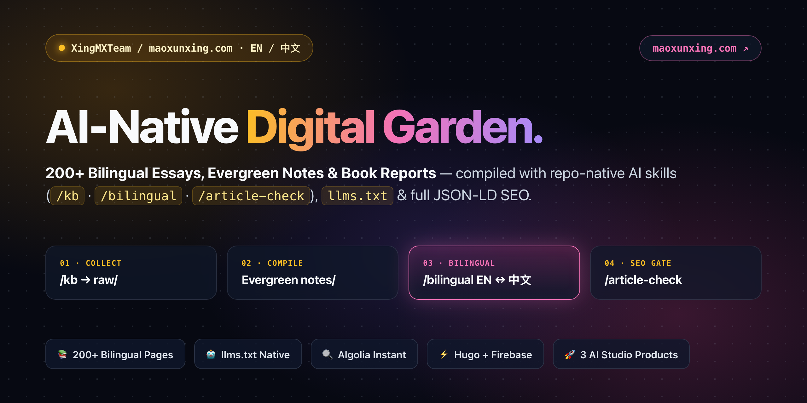
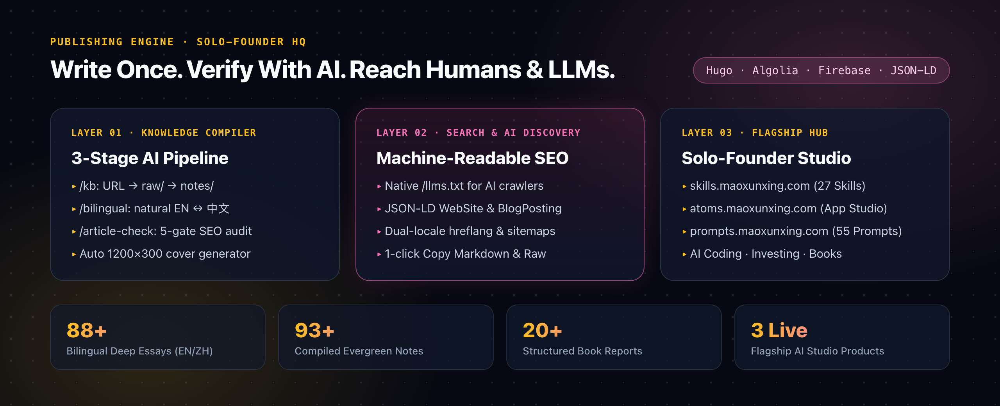

<div align="center">

<a href="https://maoxunxing.com/">
  
</a>

<br />

<p>
  <a href="https://maoxunxing.com/">
    
  </a>
  <a href="https://skills.maoxunxing.com/">
    
  </a>
  <a href="https://atoms.maoxunxing.com/">
    
  </a>
  <a href="https://prompts.maoxunxing.com/">
    
  </a>
</p>

<p>
  
  
  
  
  
</p>

<p>
  <strong>English</strong> · <a href="./README.zh-CN.md">简体中文</a> · <a href="https://maoxunxing.com/llms.txt"><code>/llms.txt</code></a>
</p>

> **Not just a Hugo blog — an AI-native bilingual digital garden, 3-layer knowledge compiler, and solo-founder HQ.**
> Powered by **200+ bilingual essays, evergreen notes & book reports (EN / 中文)**, repo-native AI authoring skills (`/kb` · `/bilingual` · `/article-check`), full **JSON-LD + `llms.txt`** discovery, and direct launchpads to Momo's live AI product studio.

</div>

---

## ✨ What Makes This Publishing Engine Different

<div align="center">
  
</div>

### 1. Repo-Native 3-Layer AI Knowledge Compiler (`.qoder/skills/`)

Instead of dumping raw drafts directly into a blog, content flows through a structured **three-layer knowledge pipeline** (`content/raw/` → `content/notes/` → `content/posts/`) automated by three custom skills living right inside this repository:

| Skill | Command Examples | What It Automates |
| :--- | :--- | :--- |
| **`/kb`**<br/>*Knowledge Base Manager* | `/kb collect https://...`<br/>`/kb compile AI`<br/>`/kb check` · `/kb preview` · `/kb list` | Fetches URLs or raw thoughts into `content/raw/`, compiles themed fragments into structured evergreen `content/notes/`, and audits duplicates & missing tags |
| **`/bilingual`**<br/>*Natural EN ↔ 中文 Engine* | Auto-triggers on single-locale posts/notes | Translates naturally (never word-for-word), preserves code blocks, URLs & domain jargon, and maps tags across languages (`知识管理` ↔ `Knowledge Management`) |
| **`/article-check`**<br/>*5-Gate SEO & Quality Audit* | `/article-check`<br/>`/article-check --fix content/posts/...` | Scores every post on **5 gates**: ≥3 English external sources, EN/ZH structural parity, frontmatter (`description` 50–160 chars, 2–5 tags), heading/code/table structure, and zero broken/non-HTTPS links |

### 2. Built for Both Humans & AI Crawlers (SEO + GEO)

- **Native [`static/llms.txt`](static/llms.txt)** — machine-readable site index tailored for LLM agents and AI search crawlers.
- **Complete JSON-LD Schema** — `WebSite` + `SearchAction` sitelinks search box ([`schema-website.html`](layouts/partials/schema-website.html)), `BlogPosting` with publisher & keywords ([`schema-article.html`](layouts/partials/schema-article.html)), and `BreadcrumbList` ([`schema-breadcrumb.html`](layouts/partials/schema-breadcrumb.html)).
- **True Bilingual Architecture (EN / ZH-CN)** — automatic `<link rel="alternate" hreflang>` + `x-default`, canonical URLs (with frontmatter override), and dual-locale XML sitemaps (`en/sitemap.xml`, `zh-cn/sitemap.xml`).
- **Developer-First Reading Experience** — instant **Algolia** browser search, one-click **Copy Markdown / View Raw / Edit on GitHub** on posts, notes & book reports, plus a unified `1200×300` cover generator (`npm run cover <slug>`).
- **Hardened Production Headers** — `HSTS`, `X-Frame-Options`, `X-Content-Type-Options`, `Referrer-Policy`, and `Permissions-Policy` configured in [`firebase.json`](firebase.json).

---

## 🚀 Flagship Hub & Content Pillars

`maoxunxing.com` is the central HQ connecting Momo's writing and live AI indie products:

| Destination | Focus | Live Link |
| :--- | :--- | :--- |
| **⚡ 27 Agent Skills** | Battle-tested frontend AI harness & 3-layer verification for Antigravity, Claude Code, Codex & Cursor | **[skills.maoxunxing.com](https://skills.maoxunxing.com/)** |
| **⚛️ Atoms Studio** | Verifiable AI App Generation — 1 sentence → real browser DOM probe + ≤3x self-repair → live preview | **[atoms.maoxunxing.com](https://atoms.maoxunxing.com/)** |
| **🧠 Prompt Studio** | 55 bilingual AI battle prompts with live `{{variable}}` filling & multi-prompt stacking | **[prompts.maoxunxing.com](https://prompts.maoxunxing.com/)** |
| **✍️ AI Coding & Indie Hacking** | 88+ bilingual deep essays, 93+ evergreen notes & 20+ structured book reports | **[maoxunxing.com](https://maoxunxing.com/)** |
| **📈 Options & Long-Term Investing** | Interactive options guide (*Options Dabaihua*) and compounding frameworks | **[maoxunxing.com/zh-cn/options-dabaihua/](https://maoxunxing.com/zh-cn/options-dabaihua/)** |

---

## 🛠️ Local Development & Architecture

**Prerequisites:** [Hugo Extended](https://gohugo.io/installation/) (`v0.111.3` recommended) and Node.js. Always run commands from the repository root (where `config.toml` lives).

```bash
# 1. Initialize theme submodule & install dependencies
git submodule update --init --recursive
npm install

# 2. Start local dev server → http://localhost:1313/
npm run start
# or: hugo server --bind 0.0.0.0 --port 1313 --baseURL http://localhost:1313 --disableFastRender
# or helper: bash scripts/ensure-dev.sh

# 3. Production minified build
rm -rf public && hugo --minify

# 4. Generate a unified 1200×300 article cover
npm run cover my-topic
```

> **macOS note:** If the shell prints `"Unable to locate a Java Runtime"`, ignore it — it is unrelated to Hugo as long as `hugo version` succeeds.

### Architecture Summary

| Area | Location & Notes |
| :--- | :--- |
| **Generator & Theme** | [Hugo](https://gohugo.io/) with [hugo-coder](https://github.com/luizdepra/hugo-coder) mounted as a git submodule under `themes/hugo-coder` (inspired by **mtlynch.io**). |
| **Custom Layouts** | Heavily overridden under [`layouts/`](layouts/) (e.g., [`layouts/_default/baseof.html`](layouts/_default/baseof.html) and custom partials). Theme upgrades require manual diffing. |
| **Styling Pipeline** | Theme SCSS fork in [`assets/scss/coder.scss`](assets/scss/coder.scss) + overrides in [`static/css/main.css`](static/css/main.css). Prefer updating variables in `assets/scss/_variables.scss` first. |
| **Bilingual Content** | Markdown bundles under [`content/`](content/) using per-locale files (`index.en.md` / `index.zh-cn.md`). |
| **Algolia Search** | Frontend uses the public search-only key in [`layouts/partials/search.html`](layouts/partials/search.html). CI indexing runs `npm run index-and-send` via [`scripts/index-and-send.sh`](scripts/index-and-send.sh) using the `ALGOLIA_ADMIN_KEY` secret (never committed to git). |

---

<details>
<summary><strong>📖 Contributing, Style Guides, HTMLProofer, Browser Matrix &amp; FFmpeg Reference</strong></summary>

### Code Style Guides

New code adheres to Google Style Guides:
- [HTML/CSS Style Guide](https://google.github.io/styleguide/htmlcssguide.html)
- [JavaScript Style Guide](https://google.github.io/styleguide/jsguide.html)
- Formatting: `npm run check-format` / `npm run format` (Prettier)

### Pull Requests

- Rebase onto `master` if conflicts arise (avoid merge commits in PRs).
- Use a crisp one-line PR summary; reference issues with `Fixes #XX`.

### HTMLProofer & Broken Links

If CI fails on a flaky external link that works in a browser, suppress it in [`tests/lint-html`](tests/lint-html) (`--ignore-urls`) with an explanatory comment. If permanently broken, replace or remove it.

### Compatibility Targets

- **OS (latest stable):** Android, iOS, Windows, macOS, Linux
- **Browsers:** Chrome, Firefox, Safari
- Test CSS/layout updates on at least one desktop OS + one mobile OS (ideally different browser engines).

### Prose Style Guide

- **Headings:** Start body headings at `##` (`<h2>`), sentence-style capitalization, no trailing punctuation.
- **POV & Readers:** First-person author (`I`), second-person reader (`you`). Call readers *"readers"* or *"visitors"* (never *"users"* or *"traffic"*).
- **Numbers & Time:** Spell out 1–9 (except multipliers like `2x`, `9x`); numerals for 10+, comma thousands (`1,000`), hyphen ranges (`200-300`), space before AM/PM (`4:30 PM`).
- **Grammar & Spelling:** Singular *"they"*, lowercase `reddit`, parenthetical `(e.g., ...)`, Oxford comma, `ebook` (no hyphen).

### Encoding Video for Posts

```bash
ffmpeg \
  -i input.avi \
  -shortest \
  -vcodec libx264 \
  -movflags +faststart \
  -vf "format=yuv420p" \
  output.mp4
```

</details>

---

<div align="center">

### Built by [Momo / 毛毛星](https://github.com/XingMXTeam)

**[🌐 maoxunxing.com](https://maoxunxing.com/)** · **[⚡ 27 Agent Skills](https://skills.maoxunxing.com/)** · **[⚛️ Atoms Studio](https://atoms.maoxunxing.com/)** · **[🧠 Prompt Studio](https://prompts.maoxunxing.com/)** · **[🔥 Playbook & 1v1](https://maoxunxing.com/zh-cn/consult/)**

<sub>Inspired by <a href="https://mtlynch.io">mtlynch.io</a> · Drop a ⭐ if this bilingual AI publishing workflow inspires your own digital garden!</sub>

</div>
