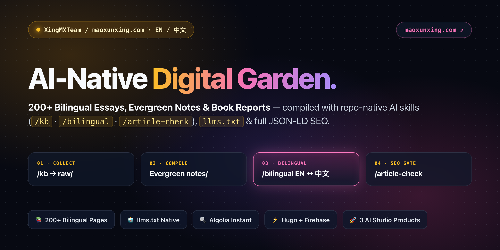
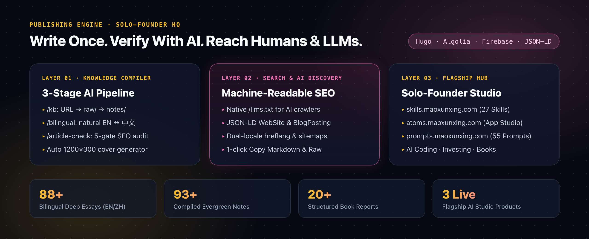

<div align="center">

<a href="https://maoxunxing.com/zh-cn/">
  
</a>

<br />

<p>
  <a href="https://maoxunxing.com/zh-cn/">
    
  </a>
  <a href="https://skills.maoxunxing.com/">
    
  </a>
  <a href="https://atoms.maoxunxing.com/">
    
  </a>
  <a href="https://prompts.maoxunxing.com/">
    
  </a>
</p>

<p>
  
  
  
  
  
</p>

<p>
  <a href="./README.md">English</a> · <strong>简体中文</strong> · <a href="https://maoxunxing.com/llms.txt"><code>/llms.txt</code></a>
</p>

> **不止是一个 Hugo 静态博客 —— 这是一套 AI 原生双语数字花园、三层知识编译流水线与一人产品工作室主站。**
> 沉淀 **200+ 篇中英双语长文、常青笔记与深度书评**，内置仓库级 AI 写作 Skills（`/kb` · `/bilingual` · `/article-check`）、完整 **JSON-LD + `llms.txt`** 面向人类与大模型的双轨检索体验，并串联 Momo 旗下全部线上 AI 产品。

</div>

---

## ✨ 为什么这套发布引擎不一样？

<div align="center">
  
</div>

### 1. 仓库原生三层 AI 知识编译器（`.qoder/skills/`）

不再把零散草稿直接丢进博客，所有内容沿 **`content/raw/` → `content/notes/` → `content/posts/`** 三层漏斗沉淀，由仓库自带的三套 AI 协作技能全自动护航：

| Skill 技能 | 常用命令 | 自动化能力 |
| :--- | :--- | :--- |
| **`/kb`**<br/>*知识库管家* | `/kb collect https://...`<br/>`/kb compile AI`<br/>`/kb check` · `/kb preview` · `/kb list` | 抓取链接或随手灵感落盘到 `content/raw/`，按主题自动编译成结构化常青 `content/notes/`，并巡检重复条目与缺失标签 |
| **`/bilingual`**<br/>*自然双语生成引擎* | 检测到单语文章/笔记自动触发 | 地道意译（拒绝机械逐字翻译），完整保留代码块、URL 与工程术语，自动对齐中英文标签（如 `知识管理` ↔ `Knowledge Management`） |
| **`/article-check`**<br/>*5 维 SEO 与质量门禁* | `/article-check`<br/>`/article-check --fix content/posts/...` | 对每篇文章执行 **5 项硬核体检**：至少 3 个英文权威参考源、中英文结构一致性、Frontmatter（摘要 50–160 字、2–5 标签）、标题/表格/代码块规范、零死链与全 HTTPS |

### 2. 同时面向人类读者与 AI 搜索引擎（SEO + GEO）

- **原生 [`static/llms.txt`](static/llms.txt)**：为大模型 Agent 与 AI 搜索引擎提供结构化全站索引。
- **全量 JSON-LD 结构化数据**：首页输出 `WebSite` + `SearchAction` 站内搜索框（[`schema-website.html`](layouts/partials/schema-website.html)），文章页自动注入 `BlogPosting`（[`schema-article.html`](layouts/partials/schema-article.html)）与 `BreadcrumbList`（[`schema-breadcrumb.html`](layouts/partials/schema-breadcrumb.html)）。
- **完整双语 SEO 体系**：全站自动注入 `<link rel="alternate" hreflang>` + `x-default`、`canonical` 规范链接及中英分语言 Sitemap（`en/sitemap.xml`、`zh-cn/sitemap.xml`）。
- **开发者级阅读与创作体验**：Algolia 前端秒级全文检索、文章页一键 **Copy Markdown / View Raw / Edit on GitHub**，以及一行命令生成统一风格 `1200×300` 封面图（`npm run cover <slug>`）。
- **生产级安全响应头**：在 [`firebase.json`](firebase.json) 中统一配置 `HSTS`、`X-Frame-Options`、`X-Content-Type-Options`、`Referrer-Policy` 与 `Permissions-Policy`。

---

## 🚀 旗下在线产品与内容支柱

| 产品 / 专栏 | 核心亮点 | 直达链接 |
| :--- | :--- | :--- |
| **⚡ 27 份前端 Agent Skills** | 面向 Antigravity / Claude Code / Codex / Cursor 的工程化 AI 协作与三层自动验收体系 | **[skills.maoxunxing.com](https://skills.maoxunxing.com/)** |
| **⚛️ Atoms Studio** | 可验证的 AI 应用生成 —— 一句话生成、真实浏览器 DOM 探针 + ≤3 轮自修复 + D1 持久化 | **[atoms.maoxunxing.com](https://atoms.maoxunxing.com/)** |
| **🧠 Prompt Studio** | 55 套中英双语实战提示词，支持 `{{变量}}` 实时填充、中英一键切换与多段组合 | **[prompts.maoxunxing.com](https://prompts.maoxunxing.com/)** |
| **✍️ AI 工程与独立开发** | 88+ 篇双语深度长文、93+ 篇常青笔记与 20+ 篇结构化深度书评 | **[maoxunxing.com/zh-cn/](https://maoxunxing.com/zh-cn/)** |
| **📈 期权大白话与长期投资** | 交互式期权入门指南与复利投资框架 | **[maoxunxing.com/zh-cn/options-dabaihua/](https://maoxunxing.com/zh-cn/options-dabaihua/)** |

---

## 🛠️ 本地运行与架构概览

**环境依赖**：[Hugo Extended](https://gohugo.io/installation/)（推荐 `v0.111.3`）与 Node.js。请始终在仓库根目录（`config.toml` 所在目录）执行命令：

```bash
# 1. 拉取主题子模块并安装依赖
git submodule update --init --recursive
npm install

# 2. 启动本地预览 → http://localhost:1313/
npm run start
# 或：hugo server --bind 0.0.0.0 --port 1313 --baseURL http://localhost:1313 --disableFastRender
# 或一键脚本：bash scripts/ensure-dev.sh

# 3. 生产压缩构建
rm -rf public && hugo --minify

# 4. 一键生成 1200×300 默认文章封面
npm run cover vue
```

### 核心目录说明

| 模块 | 说明 |
| :--- | :--- |
| **静态引擎与主题** | [Hugo](https://gohugo.io/) + [`themes/hugo-coder`](themes/hugo-coder) git submodule（站点结构灵感源自 **mtlynch.io**）。 |
| **自定义模板** | 深度覆盖于 [`layouts/`](layouts/)（含 [`layouts/_default/baseof.html`](layouts/_default/baseof.html) 与各类 Schema / 业务组件）。 |
| **样式流水线** | 主题 SCSS 定制在 [`assets/scss/coder.scss`](assets/scss/coder.scss)，补充样式在 [`static/css/main.css`](static/css/main.css)；优先调整 `assets/scss/_variables.scss` 变量。 |
| **双语内容** | 位于 [`content/`](content/)，采用同目录双文件组织（`index.en.md` / `index.zh-cn.md`）。 |
| **Algolia 索引** | 浏览器搜索仅使用公开 Search-Only Key（[`layouts/partials/search.html`](layouts/partials/search.html)）；CI 推送索引通过 GitHub Secret `ALGOLIA_ADMIN_KEY` 运行 `npm run index-and-send`（[`scripts/index-and-send.sh`](scripts/index-and-send.sh)），密钥绝不入库。 |

> 完整英文贡献指南、写作风格规范、HTMLProofer 与 FFmpeg 转码参考请参阅 [英文主 README](./README.md)。

---

<div align="center">

### 由 [Momo / 毛毛星](https://github.com/XingMXTeam) 持续构建

**[🌐 主站博客](https://maoxunxing.com/zh-cn/)** · **[⚡ 27 份 Agent Skills](https://skills.maoxunxing.com/)** · **[⚛️ Atoms Studio](https://atoms.maoxunxing.com/)** · **[🧠 Prompt Studio](https://prompts.maoxunxing.com/)** · **[🔥 知识库与 1v1 咨询](https://maoxunxing.com/zh-cn/consult/)**

<sub>如果这套 AI 驱动的双语数字花园方案对你有启发，欢迎点个 ⭐ Star！</sub>

</div>
