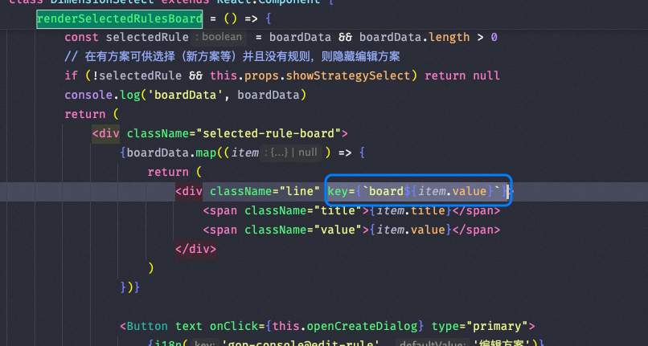

**一句话结论**：React 的一切设计都指向同一个问题——让界面在数据变化时更新得够快、够稳。从 Fiber 与时间切片打底，到 Hooks 组织逻辑、并发特性调度优先级，再到 Suspense、流式 SSR 与 Server Components 把渲染位置不断前移，这篇按这条主线把 React 的核心概念一次讲透。

> 本页由站内 8 篇写于 2019–2025 年的 React 笔记合并重组：保留原文的技术内容，统一了章节顺序与术语，个别过时表述加了校准注记。原 8 篇的链接已全部跳转到本页对应章节。


## 第一章 为什么用 React：它到底解决什么问题

先把地基说清楚：React 要解决的是 IO 延迟和 CPU 瓶颈两个问题，Fiber 与时间切片就是为此设计的底盘。后面所有章节——Hooks、并发、Suspense、SSR——都是在这套底盘上长出来的。

### 设计理念

React 的目标是创建快速响应的 Web 架构。为了实现这一目标，React 需要解决两个核心问题：

#### 1. 减少 IO 延迟
- **问题**：无法完全避免 IO 延迟，但可以通过优化 UI 交互来提升用户体验。
- **解决方案**：
  - 在某些情况下，延迟显示加载状态（如 Loading）可以改善用户的感知体验。
  - React 18 版本通过 **Suspense** 和 **useDeferredValue** 实现了更智能的加载和延迟策略。

#### 2. 解决 CPU 瓶颈
- **问题**：浏览器刷新频率为 60Hz（每 16.6ms 刷新一次），在这段时间内需要完成以下任务：
  - 执行 JavaScript 脚本（JS 线程）
  - 样式布局和绘制（GUI 渲染线程）
- 如果 JavaScript 脚本执行时间过长，会导致渲染任务无法按时完成，从而出现**掉帧**现象，表现为页面卡顿。
- **掉帧定义**：  
  > 掉帧是指由于硬件性能不足或任务耗时过长，导致帧率低于 60fps，画面出现卡顿或停滞的现象。

- **React 18 的解决方案**：
  - 引入 **时间切片（Time Slicing）** 技术，将同步的更新任务拆分为可中断的异步更新任务。
  - 使用 **Fiber 架构**，将任务分解为小单元，优先完成高优先级任务（如用户点击、动画等），确保渲染帧率稳定。

---

### 架构设计

React 的架构由三个主要部分组成：

1. **调度器（Scheduler）**  
   - 负责管理任务优先级，确保高优先级任务优先执行。

2. **协调器（Reconciler）**  
   - 负责找出变化的部分，并进行差异对比（Diffing）。

3. **渲染器（Renderer）**  
   - 负责将虚拟 DOM 转换为实际的 DOM 节点并渲染到页面上。


---

### 原理分析

#### 渲染器的工作原理
- **渲染函数**：将 JSX 转换为 DOM 节点，并通过原生 DOM API 进行渲染。
- **JSX 是什么？**
  - JSX 是一种描述组件内容的数据结构。
  - 在 React 中，Babel 会将 JSX 编译为 DSL 对象，底层通过 `React.createElement` 方法调用，生成一个属性类型为 `Element` 的对象。
  - React 组件是一个特殊的对象，可以通过 `ClassComponent.prototype.isReactComponent` 判断是否为类组件。

#### Fiber 架构
- **Fiber 节点**：  
  - Fiber 节点是虚拟 DOM 节点，也是一个对象，定义在 `packages/react-reconciler/src/ReactInternalTypes.js`。
  - Fiber 架构本质上是一棵树，每个节点作为一个单独的工作单元。
- **为什么需要 Fiber？**
  - 当 JSX 节点非常多时，直接渲染会导致长时间的任务阻塞（卡顿）。
  - Fiber 架构通过将渲染任务拆分为多个小任务，利用时间切片技术，逐步完成渲染任务，确保主线程不被长时间占用。

---

### 框架设计与功能集

现代前端框架在功能设计上通常包含以下特性：

#### 功能集
1. **约定式路由**  
   - 自动根据文件目录生成路由配置，减少手动配置的复杂性。

2. **API 路由**  
   - 提供后端 API 支持，方便前后端一体化开发。

3. **SSR + SSG**  
   - 支持服务端渲染（SSR）和静态生成（SSG），提升首屏加载速度和 SEO 效果。

4. **编译时扩展**  
   - 通过编译时的临时文件扩展框架能力，提供更高的灵活性。

5. **插件和扩展机制**  
   - 支持插件化开发，方便开发者按需引入功能模块。

---

#### 数据加载机制对比

不同的框架在数据加载机制上有各自的实现方式，以下是几种主流框架的对比：

| 框架       | 数据加载方法                     | 特点                                                         |
|------------|----------------------------------|--------------------------------------------------------------|
| **Remix**  | `export loader`                 | 通过 `loader` 方法加载数据，支持路由级别的声明式数据获取。    |
| **Umi**    | `export clientLoader`           | 提供客户端数据加载方法，结合路由和编译态优化请求速度。         |
| **Qwik**   | `export onGet`                  | 使用 `onGet` 方法加载数据，强调无绑定的懒加载能力。            |
| **Fresh**  | `export handler`                | 导出包含 `Get` 方法的处理器对象，基于 Deno 和真 Bundless 架构。 |
| **Solid Start** | `export routeData`          | 提供 `routeData` 方法，支持声明式数据获取和缓存优化。          |

---

#### 数据加载的核心思想
- **运行时库 vs 框架结合**  
  - 社区方案（如 `useEffect`、`SWR`、`React Query`）虽然能解决部分问题，但如果追求极致的请求速度，仅依赖运行时库是不够的。
  - 需要将数据加载与框架深度结合（路由和编译态结合），以实现更快的请求发起、并行执行以及缓存优化。

---

### 总结

React 的设计理念围绕着如何提升 Web 应用的响应速度展开，通过引入 **Fiber 架构** 和 **时间切片** 技术，解决了传统渲染中的性能瓶颈问题。同时，现代前端框架在功能设计上不断演进，提供了丰富的工具和机制（如约定式路由、SSR/SSG、插件扩展等），帮助开发者构建高性能的应用程序。

通过深入理解 React 的架构和原理，以及不同框架的数据加载机制，我们可以更好地选择和设计适合项目需求的技术方案。


### References

- [React Official Documentation](https://react.dev/) — Official React documentation covering core concepts and design philosophy
- [Dan Abramov — React as a UI Runtime](https://overreacted.io/react-as-a-ui-runtime/) — Deep dive into React's mental model and design decisions
- [Why React? — UI.dev](https://ui.dev/why-react) — Explanation of the problems React solves and its component model


## 第二章 Hooks：从类组件到函数组件

这章的底稿是 2019 年 Hooks 刚发布时的笔记。核心 API 至今基本稳定，个别表述已按现行版本校准；理解 Hooks 的关键不在背 API，而在它为什么取代了类组件的逻辑复用方式。

### React Hooks 的背景

在 React 的早期版本中，我们使用 `createClass` 创建组件，随后在 React v0.13.0 中引入了 `React.Component`。然而，这种方式存在一些问题：
1. **构造函数中的限制**：在 `constructor` 中必须调用 `super` 方法，并将 `props` 传递给它。
2. **手动绑定 `this`**：需要手动绑定类方法中的 `this`。

虽然可以通过 **Class Fields** 和 **箭头函数** 来避免这些问题，但仍然会面临代码重复的问题。例如：




为了解决这些问题，开发者通常会使用 **高阶组件（HOC）** 或 **Render Props** 模式来复用逻辑。然而，这些方法容易导致“包装地狱”（Wrapper Hell），并且代码可读性较差。

因此，React 团队推出了 **React Hooks**，旨在解决这些问题并提供更简洁、更灵活的开发方式。


### React Hooks 的使用

#### useState

`useState` 是 React Hooks 中最基础的一个 Hook。它的作用是管理组件的状态。

- **功能**：接受初始状态（值或函数），返回一个数组，第一个元素是当前状态，第二个元素是更新状态的函数（如 `setRepos`）。
- **与 `setState` 的区别**：
  - `setState` 管理的是整个组件的状态对象，而 `useState` 只管理单个状态。
  - `useState` 的更新函数会完全替换状态，而 `setState` 会合并状态对象。



示例代码：
```jsx
const [repos, setRepos] = useState([]);
```

#### useEffect

在传统的类组件中，生命周期方法用于同步副作用（如数据获取、订阅等）。在 React Hooks 中，`useEffect` 承担了这一职责。

- **功能**：`useEffect` 在组件渲染后执行，类似于 `componentDidMount` 和 `componentDidUpdate`。
- **触发时机**：
  - 如果未传递第二个参数，则会在每次重新渲染后执行。
  - 如果传递空数组 `[]`，则只会在初始渲染时执行。
  - 如果传递依赖项数组，则仅在依赖项变化时执行。



为了避免无限循环，建议合理设置依赖项数组。此外，`useEffect` 提供了清理机制，用于处理如事件监听器或 WebSocket 等资源释放。

示例代码：
```jsx
useEffect(() => {
  const handler = () => console.log('Window resized');
  window.addEventListener('resize', handler);
  return () => window.removeEventListener('resize', handler);
}, []);
```



#### 自定义 Hooks

React 不仅是一个 UI 组件库，还需要处理大量的非视觉逻辑。为了复用逻辑，React 提供了 **自定义 Hooks**。

- **优势**：避免 HOC 和 Render Props 的“包装地狱”，代码更易理解。
- **命名规则**：自定义 Hook 必须以 `use` 开头。

示例代码：
```jsx
function useTooltip() {
  const [visible, setVisible] = useState(false);
  return { visible, show: () => setVisible(true), hide: () => setVisible(false) };
}

// 使用自定义 Hook
const tooltip = useTooltip();
```



#### useReducer

`useReducer` 是一种基于 **Reducer 模式** 的状态管理方式，适合处理复杂的状态逻辑。

- **功能**：通过 `dispatch` 触发状态更新，类似于 Redux 的工作方式。
- **适用场景**：当组件中有多个相互关联的状态时，`useReducer` 提供了一种更声明式的方式来管理状态。

示例代码：
```jsx
const initialState = { count: 0 };

function reducer(state, action) {
  switch (action.type) {
    case 'increment':
      return { count: state.count + 1 };
    case 'decrement':
      return { count: state.count - 1 };
    default:
      throw new Error();
  }
}

const [state, dispatch] = useReducer(reducer, initialState);
```



#### useRef

`useRef` 用于在组件的多次渲染之间持久化某个值，或者访问 DOM 节点。

- **功能**：
  - 持久化值：通过 `ref.current` 访问和修改值。
  - 访问 DOM：通过 `ref` 获取 DOM 节点。

示例代码：
```jsx
const inputRef = useRef(null);

useEffect(() => {
  inputRef.current.focus();
}, []);

return <input ref={inputRef} />;
```



#### useContext

`useContext` 提供了一种跨组件共享数据的方式，避免了逐层传递 `props` 的繁琐。

示例代码：
```jsx
const ThemeContext = createContext();

function App() {
  return (
    <ThemeContext.Provider value="dark">
      <Child />
    </ThemeContext.Provider>
  );
}

function Child() {
  const theme = useContext(ThemeContext);
  return <div>{theme}</div>;
}
```




### 性能优化

#### React.memo

`React.memo` 是一个高阶组件，用于跳过不必要的重新渲染。

示例代码：
```jsx
const MemoizedComponent = React.memo(MyComponent);
```

#### useCallback

`useCallback` 用于缓存回调函数，避免在父组件重新渲染时生成新的函数实例。

示例代码：
```jsx
const handleClick = useCallback(() => {
  console.log('Clicked');
}, []);
```

#### useMemo

`useMemo` 用于缓存计算结果，避免不必要的重新计算。

示例代码：
```jsx
const memoizedValue = useMemo(() => computeExpensiveValue(a, b), [a, b]);
```




### References

- [React Hooks Documentation](https://react.dev/reference/react/hooks) — Official React documentation for all built-in hooks
- [A Complete Guide to useEffect — Dan Abramov](https://overreacted.io/a-complete-guide-to-useeffect/) — Comprehensive guide to understanding useEffect
- [Why React Hooks? — YouTube (React Conf 2018)](https://www.youtube.com/watch?v=dpw9EHDh2bM) — Sophie Alpert and Dan Abramov introducing Hooks at React Conf


## 第三章 状态管理与全局共享状态

组件自己的状态用 Hooks 管，跨组件共享的状态才是真正的设计问题：这章比较了从类组件时代到 hox 等方案的演进，落点是全局共享状态应该怎么组织。

在现代前端开发中，React 的状态管理和组件设计是构建高效、可维护应用的核心。本文将从 **Class 组件的优缺点**、**Hooks 的最佳实践**、以及 **状态管理工具的选择** 等方面展开讨论，并提供详细的分析和代码示例。

---

### Class 组件的弊端

尽管 Class 组件曾经是 React 的核心，但随着 Hooks 的引入，其一些弊端逐渐显现：

#### 1. TypeScript 类型定义复杂
- 在使用 TypeScript 时，Class 需要定义大量的类型（如接口、类属性等），而 Hooks 函数可以通过更简洁的方式实现相同功能。

#### 2. HOC 嵌套地狱
- 使用 Class 组件时，HOC（高阶组件）的层层嵌套问题较为突出。这种嵌套通常通过迭代器模式实现，容易导致代码复杂度增加。
- Hooks 则通过组合模式很好地规避了这个问题，使得逻辑更加清晰。

#### 3. Props 消费黑盒问题
- HOC 的 Props 下传过程存在“消费黑盒”现象，排查难度较大。某些 Props 可能丢失或未正确传递，从而导致渲染异常。

#### 4. 多个 HOC 的依赖关系
- 多个 HOC 之间可能存在前后依赖关系，增加了代码维护和调试的复杂性。

---

### Class 组件的优势

尽管 Hooks 更加流行，但 Class 组件在某些场景下仍然具有独特的优势：

#### 1. 数据实体消费清晰
- Class 组件基于面向对象的设计思想，数据实体的结构更加清晰，而不是散落在各个字段中。

#### 2. 扩展性强
- 对数据处理的扩展非常方便，只需新增方法即可完成对数据的操作。

#### 3. 数据关联关系明确
- 数据之间的关联关系可以通过类型判断清晰理解，便于维护和扩展。

#### 4. 多数据判断更直观
- 在需要根据多个数据进行 UI 渲染或交互时，Class 组件的表现更为直观。

---

### 最佳实践建议

结合两者的优缺点，推荐以下实践：

- **数据模型**：借助 Class 实现，利用装饰器、类元数据和依赖注入，将数据、服务和消费灵活组合。这种方式可以避免传统目录规定或特殊命名规则带来的限制，提升开发效率。
- **组件渲染**：借助 Hooks 实现，利用其简洁性和组合能力，简化组件逻辑。

---

### 如何进行状态管理？

> **破窗效应**  
> Hooks 的状态管理存在不共享、不持久的问题，数据往往是多份的，这可能导致状态同步困难。

以下是几种常见的状态管理方案及其优缺点：

---

#### 方案 1: [umi/hox](https://github.com/umijs/hox)

##### 优点
1. **持久化与全局共享**  
   - 数据可以在全局范围内共享，并支持持久化存储。
2. **灵活订阅机制**  
   - 支持订阅更新和非订阅更新，开发者可以根据需求选择是否监听状态变化。

##### 缺点
1. **持久化与非持久化的界限模糊**  
   - 如何区分持久化和非持久化的状态？例如，`createModel` 的设计是否存在边界？
2. **缺少 DevTools 支持**  
   - 无法通过工具查看状态的变化过程，调试难度较大。
3. **副作用处理能力不足**  
   - 是否可以在 Model 中直接编写副作用逻辑？这一点尚不明确。

---

#### 方案 2: Redux

Redux 是一种经典的状态管理工具，适用于大型项目。

- **优点**：状态集中管理，支持时间旅行调试（DevTools）。  
- **缺点**：学习曲线较陡，代码量较多，容易导致样板代码膨胀。

> Redux 的 reducer 文件名就是 state 的挂载对象。例如文件名是 `schedule`，那么 reducer 内部的所有状态都是挂载在 `schedule` 这个对象下。

---

#### 方案 3: Dva

Dva 是基于 Redux 的封装，提供了更简洁的 API 和内置的异步处理能力。

- **优点**：内置了 Redux-Saga，简化了异步逻辑的处理。  
- **缺点**：灵活性不如原生 Redux，可能不适合复杂的业务场景。

---

#### 方案 4: MobX

MobX 提供了一种响应式的状态管理方式，适合中小型项目。

- **优点**：使用简单，代码量少，状态变化自动触发视图更新。  
- **缺点**：对于大型项目，状态的可追踪性和调试能力可能不足。

> mobx-react 的 observer 对象（一般是 React 组件）会监听 store 的数据（`@observable` 的数据变化时会触发）变化，并且会重新渲染。

---

#### 方案 5: Immer

Immer 是一个不可变数据管理库，常用于简化状态更新逻辑。**不是一个状态管理方案**

- **优点**：通过简单的 API 实现不可变数据操作，代码更易读。  
- **缺点**：仅解决状态更新问题，需与其他状态管理工具配合使用。

```js
import {produce} from "immer"

const nextState = produce(baseState, draft => {
    draft[1].done = true
    draft.push({title: "Tweet about it"})
})
```

vs

```js
const nextState = baseState.slice() // shallow clone the array
nextState[1] = {
    // replace element 1...
    ...nextState[1], // with a shallow clone of element 1
    done: true // ...combined with the desired update
}
// since nextState was freshly cloned, using push is safe here,
// but doing the same thing at any arbitrary time in the future would
// violate the immutability principles and introduce a bug!
nextState.push({title: "Tweet about it"})
```

---

#### 方案 6: zustand 和 valtio

在早期的前端开发中，我们常用 Redux、Dva 或 React Context 来管理状态。然而，这些工具在某些场景下存在局限性，例如：
- **Redux** 的样板代码过多，学习曲线陡峭。
- **React Context** 在多渲染器环境下可能出现上下文丢失（Context Loss）的问题。
- **Hooks** 在处理异步操作和复杂状态逻辑时容易出现“过时的 Props”或“僵尸子组件”等问题。

zustand 和 valtio 是新一代的状态管理工具，解决了上述问题，并提供了更简洁的 API 和更好的性能表现。对于新手开发者来说，这两个库几乎可以无脑选择。

##### zustand 的核心优势

###### Stale Props 和 Zombie Children 问题

###### 什么是 Stale Props？
Stale Props 指的是在异步操作完成之前，组件重新渲染导致使用了过时的 Props。这可能导致获取到错误的数据。
```js
const ExampleComponent = ({ id }) => {
  const [data, setData] = useState(null)
  useEffect(() => {
	  fetchData(id)
  }, [id])		
  const fetchData = id => {
	  const response = await fetch(`https://api.example.com/${id}`)
	  setData(response.json())
  }
  return <>{data ? <div>{data.description}</div> : <div>Loading</div></>
}
```
在异步拉取数据完成之前，如果id再次变化，就会出现`Stale Props` 的问题，使用了过期的id获取了不正确的数据。

###### 什么是 Zombie Children？
Zombie Children 指的是在异步操作期间，父组件已经卸载或更新，但之前的子组件仍然存在于 DOM 中。

以下是一个示例：
```js
const ExampleComponent = ({ id }) => {
  const [data, setData] = useState(null);
  useEffect(() => {
    fetchData(id);
  }, [id]);
  const fetchData = async (id) => {
    const response = await fetch(`https://api.example.com/${id}`);
    setData(response.json());
  };
  return data ? <div>{data.description}</div> : <div>Loading</div>;
};
```
如果 `id` 在异步请求完成前发生变化，就可能出现 Stale Props 问题；如果组件被卸载，可能还会导致 Zombie Children 问题。
###### 解决react concurrency问题。 

这个问题是说React在并发模式下可能导致渲染过程中发生突变导致的撕裂，更新被中断或者中途改变，使组件UI显示不一致或者报错。并发模式下，React可能将渲染工作分成多个时间片，并在每个时间片中执行一部分渲染工作。


```js
import React, { useState } from 'react';

const Counter = () => {
  const [count, setCount] = useState(0);

  const handleClick = () => {
    // 在渲染函数中直接修改状态
    setCount(count + 1);
    console.log(count); // 这里的 count 可能不是最新的值
  };

  return (
    <div>
      <h1>Count: {count}</h1>
      <button onClick={handleClick}>Increment</button>
    </div>
  );
};

export default Counter;
```

```js
import React, { useState } from 'react';

const Counter = () => {
  const [count, setCount] = useState(0);

  const handleClick = () => {
    // 使用函数式更新来确保获取最新的 count 值
    setCount(prevCount => prevCount + 1);
  };

  return (
    <div>
      <h1>Count: {count}</h1>
      <button onClick={handleClick}>Increment</button>
    </div>
  );
};

export default Counter;
```

###### zustand 如何解决？
zustand 使用了 **Immer** 库来保证状态的不可变性，确保每次状态更新都基于最新的状态副本。这样可以避免因使用过时数据而导致的问题。

以下是用 zustand 改写的示例：
```js
const useExampleStore = create((set) => ({
  data: null,
  loading: false,
  error: null,
  fetchData: async (id) => {
    set({ loading: true });
    try {
      const response = await fetch(`https://api.example.com/${id}`);
      set({ data: response.json(), loading: false });
    } catch (error) {
      set({ error, loading: false });
    }
  },
}));
const ExampleComponent = ({ id }) => {
  const { data, loading, error, fetchData } = useExampleStore();
  useEffect(() => {
    fetchData(id);
  }, [id]);
  return data ? <div>{data.description}</div> : <div>Loading</div>;
};
```

通过这种方式，zustand 确保了状态的最新性，避免了 Stale Props 和 Zombie Children 问题。

##### 教程
1、不可变状态的合并： 
 1.1、set方法会自动合并
 
```js
// 正确
set((state) => ({ count: state.count + 1 }))
// 通过第二个参数，禁止state合并
set((state) => ({ count: state.count + 1 }, true))
// 通过第三个参数，提供状态变更的原因，devtools使用到
set((state) => ({ count: state.count + 1 }, false, '增加count'))
// ...state可以省略，
set((state) => ({ ...state, count: state.count + 1 })) 
```
 1.2、如果是嵌套对象，需要手动合并。[更多](https://github.com/pmndrs/zustand/blob/main/docs/guides/updating-state.md#deeply-nested-object)
```js
import { create } from 'zustand'

const useCountStore = create((set) => ({
  nested: { count: 0 },
  inc: () =>
    set((state) => ({
      nested: { ...state.nested, count: state.nested.count + 1 },
    })),
}))
```
2、selector的用法：
selector类似Redux的selector或者MobX的computed属性，比如我们有一个store
```js
import create from 'zustand';

const useStore = create((set) => ({
  count: 0,
  increment: () => set((state) => ({ count: state.count + 1 })),
  decrement: () => set((state) => ({ count: state.count - 1 })),
}));

export default useStore;
```
这里我们通过useStore访问store，并且传递进去两个selector， 他们通过获取部分状态派生出新的值，而不用访问整个状态树。

也就是说如果我们要复用state.count * 2 的逻辑，可以写两个函数，函数因为是纯函数可以单独测试。
```js
import useStore from './useStore';

const Counter = () => {
  const count = useStore((state) => state.count);
  const doubleCount = useStore((state) => state.count * 2);

  return (
    <div>
      <p>Count: {count}</p>
      <p>Double Count: {doubleCount}</p>
    </div>
  );
};

export default Counter;
```


---

##### valtio 简介

valtio 是另一个由 dai shi 开发的状态管理库，基于 Proxy 对象实现。它的功能与 zustand 类似，但 API 风格有所不同。valtio 更加轻量级，适合喜欢简单 API 的开发者。

```js
import { proxy, useSnapshot } from 'valtio';
const state = proxy({
  count: 0,
});
const Counter = () => {
  const snap = useSnapshot(state);
  return (
    <div>
      <p>Count: {snap.count}</p>
      <button onClick={() => (state.count += 1)}>Increment</button>
    </div>
  );
};
export default Counter;
```


##### zustand vs valtio

valtio获取值的时候可以直接抛Promise。

```js
const state = proxy({ post: fetch(url).then((res) => res.json()) })

function Post() {
  const snap = useSnapshot(state); 
  // 相当于当post.title不存在的时候，直接抛了一个Promise
  // 不需要额外处理加载状态和错误处理逻辑（Suspense组件处理了）
  return <div>{snap.post.title}</div> 
}

function App() {
  return (
    <Suspense fallback={<span>waiting...</span>}>
      <Post />
    </Suspense>
  )
}
```

zustand则不能
```js
// 1、创建store
import create from 'zustand';

const postStore = create((set) => ({
  post: null,
  getPost: async (url) => {
    const response = await fetch(url);
    const data = await response.json();
    set({ post: data });
  },
}));

// 2、使用store
import { useStore } from './postStore';

function Post() {
  const post = useStore((state) => state.post);
  const getPost = useStore((state) => state.getPost);

  // 这里需要自己处理Promise 
  if (!post) {
    getPost(url); // 直接调用获取数据的方法
    throw getPost(url); // 直接抛出 Promise
  }

  return <div>{post.title}</div>;
}
```
可以借助swr改进：[复杂例子](https://gist.github.com/samselikoff/ac8076c6c224786da23c9297567585cf), [SWR改进](https://codesandbox.io/s/react-suspense-swr-zustand-uyj1ub?file=/src/store.ts:0-582)

```js
import useSWR from "swr";
import create from "zustand";

// fetch data from `jsonplaceholder` API
const fetcher = (
  type: "user" | "post" | "photo",
  id: string,
  delay: number
) => {
  const url = `https://jsonplaceholder.typicode.com/${type}s/${id}?_delay=${delay}`;

  return fetch(url).then((res) => res.json());
};

export const useStore = create((set) => ({
  userInfo: null,
  useFetch: (key) =>
    useSWR(key, fetcher, {
      suspense: true,
      // 如果需要数据保存，则可以在 onSucces 里把数据 set 下来
      onSuccess: (data) => {
        set({ userInfo: data });
      }
    })
}));
```


---

### 总结

在实际项目中，选择合适的状态管理工具和组件设计方式至关重要。以下是一些总结建议：

- **Class 组件**：适合数据模型复杂、扩展性强的场景。
- **Hooks**：适合组件逻辑简单、需要组合能力的场景。
- **状态管理工具**：根据项目规模和复杂度选择合适的工具，例如 Redux、MobX、zustand 或 valtio。

---

### 全局共享状态设计

如何设计一个简单的全局共享状态管理器

1、创建模型：
```js
const model = getModel("foo");  // 创建或获取已存在的模型
```

2、创建容器和监听器：
- 创建一个 Container 存储状态 （ 订阅者共享一个实例）
- 创建一个隐藏的 Executor 组件来监听状态变化（相当于中介者，数据变化后调用每个订阅组件的setState触发重新渲染）

3、订阅状态：
- 组件通过 useModel 订阅状态变化
- 当状态变化时，组件会自动更新


[Git Repo](https://github.com/XingMXTeam/reactivity.git)

1、和zustand、Jotai、 mobx-react-lite 实现的区别？
2、React原生实现Context的区别？需要嵌套包裹组件

新的直觉：
1、组件里面useModel实际就是订阅；通过中间组件订阅更新；通过container观察者模式通知
2、`const { data, setData } = useModel('bannerComponent')` 只会订阅你想要的这个组件的数据， `setData` 也只会更新指定组件的数据。


### References

- [Zustand GitHub Repository](https://github.com/pmndrs/zustand) — Lightweight state management library for React
- [Redux Toolkit Documentation](https://redux-toolkit.js.org/) — Official Redux Toolkit documentation and best practices
- [Practical React State Management — Kent C. Dodds](https://kentcdodds.com/blog/application-state-management-with-react) — Guide to choosing the right state management approach


## 第四章 并发渲染：时间切片与优先级调度

术语先对齐：原文写作时「并发模式（Concurrent Mode）」还是一个需要开启的模式；React 18 正式版之后，官方不再把它当独立模式，而是拆成一组按需启用的并发特性——useTransition、useDeferredValue、Suspense。本章保留原文脉络，读的时候把「并发模式」理解为「并发特性」即可。

### 设计初衷

**Concurrent Mode** 是 React 框架的一种新特性，旨在提高 React 应用的响应速度和用户体验。它通过允许 React 同时处理多个任务，而不是按顺序完成每个任务，从而提升性能和交互流畅性。

---

### 关键概念与优势

#### 时间切片（Time Slicing）

**时间切片** 是指 React 在处理某个任务时，可以随时暂停并切换到其他更高优先级的任务。这种机制被称为 **时间切片**，可以防止长时间任务阻塞主线程，确保用户界面的流畅性。

##### 触发场景：
- 复杂的计算或渲染任务。
- 大量 DOM 更新导致主线程被长时间占用。
- 动画和用户交互需要保持流畅时。

---

#### 优先级调度（Priority Scheduling）

在 **Concurrent Mode** 中，不同的任务可以分配不同的优先级。例如，用户输入的处理优先级会高于数据加载的优先级。这种调度机制可以使高优先级任务优先得到处理，从而提高用户体验。

##### 触发场景：
- 用户输入（如键盘输入、鼠标点击）需要快速响应。
- 网络请求和数据加载可以延迟处理。
- 组件状态更新和重渲染的优先级可能不同。

##### 示例：
- 如果用户在一个复杂的页面上滚动，同时后台正在进行数据加载，时间切片可以让 React 暂停数据加载的处理，确保滚动操作流畅。
- 如果用户在表单中输入数据，优先级调度会确保输入事件得到快速响应，而后台的数据同步可能被延迟。

---

#### 暂停、恢复和丢弃渲染

##### 暂停渲染：
- 用户在一个数据密集型的页面上滚动。React 会暂停数据密集型组件的渲染，以确保滚动操作流畅。

##### 恢复渲染：
- 用户停止滚动，React 在浏览器的空闲时间继续之前被暂停的数据密集型组件的渲染。

##### 丢弃渲染：
- 用户快速切换不同的页面或视图。React 会丢弃那些还未完成的、但已经不再需要的渲染任务，以避免不必要的计算。

---

#### Suspense

**Suspense** 是 Concurrent Mode 中的重要特性，允许组件在等待异步数据加载时 "挂起" 渲染，直到数据准备好。这样可以更优雅地处理异步操作，提供更好的用户体验。

---

#### 自动批量更新（Automatic Batching of Updates）

**自动批量更新** 是指 React 自动将多个状态更新批量处理，从而减少重新渲染的次数，提高性能。

##### 触发场景：
- **事件处理函数中**（React 18 版本之前也会批量处理更新）：
  ```jsx
  function handleClick() {
    setState1(value1);
    setState2(value2);
    // React 会在事件处理函数执行完毕后一次性进行重新渲染
  }
  ```

- **生命周期方法和副作用中**：
  ```jsx
  useEffect(() => {
    setState1(value1);
    setState2(value2);
    // React 会在 useEffect 完成后一次性进行重新渲染
  }, []);
  ```

- **异步操作中**：
  ```jsx
  setTimeout(() => {
    setState1(value1);
    setState2(value2);
  }, 1000);
  ```

##### 如何退出批量更新：
  ```jsx
  import { flushSync } from 'react-dom';
  setTimeout(() => {
    flushSync(() => {
      setState1(value1);
    });
    flushSync(() => { 
      setState2(value2);
    });
  }, 1000);
  ```

---

### 如何开启 Concurrent Mode

一旦你使用 `createRoot` 创建了根节点，所有子树组件将自动运行在并发模式下：

```jsx
// index.js
import React from 'react';
import ReactDOM from 'react-dom/client';
import App from './App';

const rootElement = document.getElementById('root');
const root = ReactDOM.createRoot(rootElement);

root.render(
  <React.StrictMode>
    <App />
  </React.StrictMode>
);
```

---

### 核心 API 详解

#### useTransition

**useTransition** 允许你告诉 React 某些更新是非紧急的，从而优化用户体验。

##### 示例：
```jsx
import React, { useState, useTransition } from 'react';

function App() {
  const [isPending, startTransition] = useTransition();
  const [count, setCount] = useState(0);

  const handleClick = () => {
    startTransition(() => {
      setCount(c => c + 1);
    });
  };

  return (
    <div>
      <button onClick={handleClick}>Increment</button>
      {isPending ? <p>Loading...</p> : <p>Count: {count}</p>}
    </div>
  );
}

export default App;
```

---

#### useDeferredValue

**useDeferredValue** 延迟更新 UI，适用于跟随输入的情况。它告诉 React 这是一次非紧急更新。

##### 示例：
```jsx
import React, { useState, useDeferredValue } from 'react';

function App() {
  const [text, setText] = useState('');
  const deferredText = useDeferredValue(text);

  const handleChange = (event) => {
    setText(event.target.value);
  };

  return (
    <div>
      <input type="text" value={text} onChange={handleChange} />
      <p>Deferred Text: {deferredText}</p>
    </div>
  );
}

export default App;
```

---

#### useSyncExternalStore

**useSyncExternalStore** 是 React 18 中引入的一个新钩子，用于确保外部存储的同步更新。它主要用于处理那些 React 状态之外的状态源，比如 Redux、MobX、Zustand 或其他自定义存储解决方案。

##### 关键点：
1. **同步更新**：确保 React 组件在外部存储更新时能同步更新。
2. **无缝集成**：提供一种标准的方式，将外部存储与 React 组件集成。
3. **稳定的 API**：适用于所有需要与 React 组件同步的外部存储解决方案。

##### 使用场景：
- 状态管理库（如 Redux、MobX、Zustand）。
- 自定义存储解决方案。
- 性能优化。

##### 示例：
```jsx
// store.js
let state = { count: 0 };
let listeners = new Set();

function getState() {
  return state;
}

function setState(newState) {
  state = newState;
  listeners.forEach(listener => listener());
}

function subscribe(listener) {
  listeners.add(listener);
  return () => listeners.delete(listener);
}

export { getState, setState, subscribe };
```

```jsx
// App.js
import React from 'react';
import { useSyncExternalStore } from 'react';
import { getState, setState, subscribe } from './store';

function useStore(selector) {
  return useSyncExternalStore(subscribe, () => selector(getState()));
}

function App() {
  const count = useStore(state => state.count);

  const increment = () => {
    setState({ count: count + 1 });
  };

  return (
    <div>
      <p>Count: {count}</p>
      <button onClick={increment}>Increment</button>
    </div>
  );
}

export default App;
```

---

### 版本要求

- **React >= 18**

---

### 总结

**Concurrent Mode** 是 React 的一项重要特性，通过时间切片、优先级调度、暂停/恢复/丢弃渲染等机制，显著提升了应用的响应速度和用户体验。结合 `useTransition`、`useDeferredValue` 和 `useSyncExternalStore` 等 API，开发者可以更灵活地优化复杂场景下的性能问题。


### References

- [React Concurrent Features](https://react.dev/blog/2022/03/29/react-v18#new-feature-concurrent-rendering) — Official React 18 concurrent rendering announcement
- [Inside React Query — TkDodo](https://tkdodo.eu/blog/inside-react-query) — Deep dive into concurrent features in React data fetching
- [Understanding React Concurrent Mode — LogRocket](https://blog.logrocket.com/react-concurrent-mode/) — Practical guide to React concurrent features


## 第五章 Suspense：声明式加载状态

并发特性里最先落地的就是 Suspense：加载状态不再靠手写 isLoading 标志位，而是声明式地交给 React 在合适的时机展示后备 UI。

### 设计初衷

`React.Suspense` 是专为处理异步组件而设计的，旨在简化异步操作（如懒加载、数据获取等）的开发体验。其主要应用场景包括：

- **Code-Splitting**：通过 `React.lazy` 实现按需加载组件（React 16.6 引入）。
- **Concurrent Features**：在 React 18 中，支持基于并发特性的异步数据获取。
- **异步数据加载**：与 Relay 等库集成，实现声明式的异步数据加载。

> **注意**：只有使用 `use()` 的数据源才会触发 Suspense 的行为。

此外，`Suspense` 在 **服务端渲染（SSR）** 中也发挥了重要作用，可以捕获组件渲染中的异常，提供更优雅的错误处理机制。

---

### 核心功能

#### 1. 声明式加载状态
- 提供了一种声明式的方式，在等待组件加载时显示 fallback UI（如加载动画或占位符）。
- 当请求足够快时，可以略过 `loading` 状态的展示，提升用户体验。

#### 2. 异常捕获
- 类似于 JavaScript 的 `try...catch`，`Suspense` 可以捕获组件渲染中的异常，并显示 fallback UI。

#### 3. 嵌套支持
- 支持嵌套使用，允许开发者在不同层级上定义不同的 fallback 行为。

---

### 示例代码

以下是一个典型的 `React.Suspense` 使用场景，展示了如何结合 `React.lazy` 实现懒加载组件：

```jsx
import React, { Suspense, lazy } from 'react';

// 懒加载组件
const LazyComponent = lazy(() => import('./LazyComponent'));

// 使用 Suspense 包裹懒加载组件
const SuspenseWithLazyLoading = () => (
    <Suspense fallback={<div className="spinner">Loading component...</div>}>
        <LazyComponent />
    </Suspense>
);

export default SuspenseWithLazyLoading;
```

---

### 与传统方法的对比

#### 1. `useState` 和 `setLoading`
- **传统方式**：通过 `useState` 和 `setLoading` 手动管理异步数据加载的状态。
- **问题**：
  - 需要显式地控制加载状态，代码复杂度较高。
  - 容易触发额外的组件刷新。

#### 2. 使用 `Suspense`
- **优势**：
  - **声明式**：无需手动管理加载状态，代码更加简洁。
  - **避免额外刷新**：不会因为状态更新导致不必要的重新渲染。
  - **智能跳过 loading**：当请求足够快时，可以直接跳过 `loading` 状态的展示。

---

### 特性总结

- **声明式加载**：通过 `fallback` 属性定义加载时的 UI。
- **异常捕获**：类似于 `try...catch`，能够捕获组件渲染中的异常。
- **嵌套支持**：可以在不同层级上定义独立的 fallback 行为。
- **优化体验**：当请求足够快时，可以略过 `loading` 状态的展示。

---

### 版本要求

- **React >= 18**

从 React 18 开始，`Suspense` 的功能得到了进一步增强，特别是在并发模式下的异步数据获取和懒加载方面表现尤为突出。

---

### 总结

`React.Suspense` 是一种强大的工具，用于处理异步操作（如懒加载和数据获取）。它通过声明式的方式简化了异步状态管理，提升了代码的可读性和维护性。同时，它的智能加载机制和异常捕获能力，使得开发者能够更轻松地构建高性能的 Web 应用。

无论是服务端渲染还是客户端渲染，`Suspense` 都能为开发者提供一致且高效的解决方案。


### References

- [React Suspense Documentation](https://react.dev/reference/react/Suspense) — Official React documentation for the Suspense component
- [Dan Abramov — Algebraic Effects for the Rest of Us](https://overreacted.io/algebraic-effects-for-the-rest-of-us/) — Understanding the theory behind React Suspense
- [React Lazy Loading Guide — web.dev](https://web.dev/articles/code-splitting-suspense) — Google's guide to code splitting with React Suspense


## 第六章 SSR 与流式渲染

服务端渲染解决的是首屏与 SEO，流式渲染再往前一步：不等整页数据齐了才发，先把壳送到浏览器，慢的部分好了再补。

### React SSR 的历史

React 的服务端渲染（SSR）经历了多个版本的演进，以下是其发展的重要里程碑：

- **v0.4**：推出 `React.renderComponentToString` API，开始支持服务端渲染（SSR）。
- **v0.12**：推出 `React.renderToString` 替代原有的 API。
- **2015年 v0.14**：拆分出 `react-dom` 包，更新 API 调用方式为 `ReactDOMServer.renderToString` 和 `renderToStaticMarkup`。
- **2016年 v16**：推出 `ReactDOMServer.renderToNodeStream` 和 `renderToStaticNodeStream`，支持流式渲染。
- **2020年**：推出 RSC（React Server Component），进一步优化服务端渲染能力。
- **2022年 v18**：推出 `renderToReadableStream` 和 `renderToPipeableStream`，实现全新的服务端渲染器。

---

### 设计初衷

通过服务端生成并完成渲染内容，React 的 SSR 提供了比客户端渲染（CSR）更快的首次内容绘制时间。以下是 SSR 的主要优势：

1. **更快的首次内容绘制时间**  
   - 因为是流式的，可以更快地看到内容。
   
2. **更低的服务器资源消耗**  
   - 流式渲染允许边生成边传输，降低服务负载和资源消耗，更好地处理并发请求。

#### 示例代码

##### 服务端渲染
```jsx
import { renderToString } from 'react-dom/server';

app.use('/', (request, response) => {
  const html = renderToString(<App />);
  response.send(html);
});
```

##### 客户端水合
```jsx
import { hydrateRoot } from 'react-dom/client';
import App from './App.js';

hydrateRoot(document.getElementById('root'), <App />);
```

---

### React v16 SSR 的改进

相比 v15，React v16 的 SSR 在以下几个方面进行了优化：

1. **生成的 HTML 体积更小**  
   - 去掉了 `data-reactId` 属性和注释，减少了 HTML 文件的大小。

2. **水合更宽松**  
   - 更宽松的属性检测。
   - 只替换不匹配的 HTML 子树，而不是重新渲染整个组件树。

3. **速度更快**  
   - 移除了 `process.env.NODE_ENV` 的依赖。
   - 在服务端渲染中不涉及任何虚拟 DOM 的逻辑，提升了渲染效率。

---

### React v18 SSR 的改进

React v18 引入了多项改进，进一步优化了 SSR 的性能和体验：

1. **错误处理与水合回退**  
   - 在服务端发生错误或水合不匹配时，不再自动回退到客户端渲染（CSR）。通过 `Suspense`，React 能够识别边界并进行局部回退。
   ```jsx
   <Suspense fallback={<Loading />}>
     <Component />
   </Suspense>
   ```

2. **异步水合**  
   - 对 `Hydrate` 进行了异步处理，让先渲染的部分达到可交互状态，从而提升首屏体验，特别是在接口较慢的应用中。

---

### 流式 SSR 的实现

流式 SSR 是服务端渲染的一种形式，它的特点是实时生成 HTML 片段并发送给客户端。

#### 示例代码
```jsx
import { renderToPipeableStream } from 'react-dom/server';

const { pipe } = renderToPipeableStream(<App />, {
  bootstrapScripts: ['./main.js'],
  onShellReady() {
    response.setHeader('content-type', 'text/html');
    pipe(response);
  },
});
```

#### 解决传统 SSR 的问题

传统的 SSR 执行步骤如下：
1. **Fetch Data**：必须先准备好所有数据才能将组件渲染为 HTML。
2. **Load JS**：必须加载客户端的所有组件代码，然后才能开始对其中的组件进行水合。
3. **Hydration**：必须等所有的组件都水合完成后，才能对组件进行交互。

##### 解决方案
通过服务端渲染器以乱序流式 HTML，结合 `Suspense` 的能力，可以刷新之前生成的 HTML。

- **示例代码**
```jsx
<Layout>
  <NavBar />
  <SideBar />
  <RightPane>
    <Post />
    <Suspense fallback={<Spinner />}>
      <Comments />
    </Suspense>
  </RightPane>
</Layout>

import { use } from 'react';

function Comments() {
  const comments = use(fetch('./api/comments'));
  return (
    <>
      {comments.map((comment, i) => {
        return <p key={i}>{comment}</p>;
      })}
    </>
  );
}
```

在 React v18 中，`Comments` 组件的脚本加载之前即可开始水合。如果数据已经就位但 JavaScript 代码尚未加载完成，React 会先进行一次水合；当脚本加载完成后，会再次进行水合。

##### 懒加载组件
```jsx
import { lazy } from 'react';

const Comments = lazy(() => import('./comments.js'));

<Suspense fallback={<Spinner />}>
  <Comments />
</Suspense>
```

---

### 什么是水合？

**水合（Hydration）** 是指 React 接管由服务端生成的 HTML 节点（通常是同构的 React 组件），主要是将事件绑定上去，使组件变得可交互。

- **过程**：
  1. React 将服务端生成的静态 HTML 转换为动态的、可交互的组件。
  2. 在客户端上附加事件监听器和其他交互逻辑。

- **重要性**：
  - 水合是 SSR 的关键步骤，确保服务端生成的内容能够在客户端上正常工作。

---

### 总结

React 的服务端渲染从早期的简单字符串渲染，逐步演进到流式渲染和异步水合，极大地提升了应用的性能和用户体验。通过引入 `Suspense` 和 `React Server Components` 等新特性，React v18 进一步优化了 SSR 的灵活性和效率。未来，随着技术的不断发展，React 的 SSR 能力将继续为开发者提供更强大的工具来构建高性能的 Web 应用。


### References

- [New Suspense SSR Architecture in React 18](https://github.com/reactwg/react-18/discussions/37) — Official React Working Group discussion on streaming SSR
- [Rendering on the Web — web.dev](https://web.dev/articles/rendering-on-the-web) — Google's comprehensive guide to web rendering strategies
- [React 18 Streaming SSR — YouTube (Jack Herrington)](https://www.youtube.com/watch?v=o3JWb04DRIs) — Video tutorial on React 18 streaming SSR implementation


## 第七章 Server Components：在服务端跑的组件

RSC 把组件的执行位置再往前推：有些组件根本不需要出现在客户端，在服务端算完只把结果送下来，客户端 JS 负载和数据获取一起瘦身。

### 设计初衷

React Server Components（RSC）的引入旨在提升 React 应用的性能和开发体验，主要体现在以下几个方面：

#### 1. 减少客户端 JavaScript 负载
- **特点**：RSC 允许开发者将部分逻辑留在服务器端执行，减少需要发送到客户端的 JavaScript 代码量。
- **优势**：显著提升应用的加载性能，尤其对于大型应用或复杂页面。

#### 2. 更高效的数据获取
- **特点**：RSC 能够在服务器端直接获取数据并渲染组件。
- **优势**：避免了客户端额外的网络请求，减少了延迟。

#### 3. 优化 SEO 和初始加载性能
- **特点**：初次加载时就能向客户端返回完整的 HTML 页面。
- **优势**：搜索引擎更容易抓取内容，同时提升了用户的首次访问体验。

#### 4. 提高开发体验
- **特点**：可以在同一个项目中混合使用客户端组件和服务器组件。
- **优势**：开发者可以根据需求灵活选择组件类型，简化开发流程。

#### 5. 更好地利用服务器资源
- **特点**：充分利用服务器的计算资源，减轻客户端设备的负担。
- **优势**：特别适合移动设备或低性能设备用户，提供更流畅的体验。

---

### 什么是 RSC？

通过服务端将 JSX（这里的 JSX 就是 RSC 组件）转换为 HTML，然后发送给客户端进行渲染。这就是服务端渲染（SSR）。  
RSC 的核心思想是通过 JS 发送请求获取最新的区块 HTML，并通过水合替换区块内容。

#### 特点
1. **无感刷新**：只更新特定区块的内容，其他区块的状态保持不变。
2. **劫持 `<a>` 标签点击**：通过 `pushState` 模拟页面刷新，结合 RSC 组件的方式替换刷新内容，从而实现无感替换。

---

### 如何实现 RSC？

#### 服务端渲染流程
1. **字符串返回 HTML**  
   正常情况下，服务端可以直接将 HTML 字符串返回给客户端。
   
2. **使用 Babel 插件处理 JSX**  
   - 使用 `node-jsx-loader` 插件，可以在服务端编写 JSX。
   - 该插件会将 JSX 转换为一个 JS 对象（包含 `type` 和 `props`），这个对象可以进一步转换为 HTML 并发送给客户端。

---

### 核心方法解析

#### 1. `renderJSXToClientJSX`
- **作用**：服务端将 JSX 组件转换为 JSX 对象，然后将其序列化为 JSON 传递给客户端。
- **优势**：客户端接收到 JSON 后，可以直接更新 DOM，无需重新加载整个页面。

#### 2. `renderToString`
- **作用**：将 JSX 转换为字符串形式的 HTML，发送到浏览器后由客户端进行水合（Hydration）。
- **适用场景**：适用于传统的 SSR 场景。

---

### RSC 与 SSR 的关系

- **独立但可结合**  
  服务器组件（RSC）和服务器渲染（SSR）是两种独立的技术，但它们可以结合使用，构建跨服务器和客户端的应用程序。
  
- **区别**  
  - **SSR**：产出的是 HTML。
  - **RSC**：产出的是指令，用于指导客户端如何更新特定区块的内容。

---

### 总结

React Server Components 的引入为现代 Web 应用带来了诸多优势：
- 减少了客户端 JavaScript 的负载，提升了加载性能。
- 在服务器端完成数据获取和渲染，优化了用户体验。
- 支持无感刷新和状态保持，增强了交互体验。
- 灵活的开发模式允许开发者根据需求自由选择组件类型。

通过 `renderJSXToClientJSX` 和 `renderToString` 等核心方法，RSC 实现了高效的跨端协作。未来，随着技术的不断发展，RSC 将继续为开发者提供更强大的工具来构建高性能、高体验的 Web 应用。

---

### React.use API

**概述：**  
React.use API 可以让组件在服务端和客户端之间实现同构渲染，并自动回退到 CSR（客户端渲染）。

**案例：**  
适用于 RSC（React Server Components）场景。

---

### RSC 与 RCC（React Client Component) 的区别

| **概念**       | **描述**                                                                 |
| -------------- | ------------------------------------------------------------------------ |
| RSC            | 从后端获取数据的组件，通常用于服务端渲染。                                                |
| RCC            | 包含数据的可交互组件，通常运行在客户端，支持用户交互。                                       |

**案例：**  
RSC 和 RCC 是 React Server Components 中的核心概念，分别负责服务端和客户端的职责划分。

---

### SSG、RSC 和 SSR 的对比

| **方案**       | **描述**                                                                 |
| -------------- | ------------------------------------------------------------------------ |
| SSG            | 编译时方案，在构建阶段生成静态 HTML 文件。                                               |
| RSC            | 运行时方案，输出类 JSON 数据结构，支持流式传输。                                           |
| SSR            | 运行时方案，输出完整的 HTML 文件。                                                   |

**特点：**  
- RSC 和 SSR 可以同时存在。
- SSG 更适合静态内容，RSC 和 SSR 更适合动态内容。

**案例：**  
RSC 的流式输出可以显著提升首屏加载性能，同时支持动态数据更新。

---

### RSC 和 RCC 的交互规则

| **规则**       | **描述**                                                                 |
| -------------- | ------------------------------------------------------------------------ |
| RSC 和 RCC     | 可以交替出现，但 RCC 不能直接 import RSC。                                             |
| RSC 使用 RCC   | RSC 可以通过 `children` 方式使用 RCC，因为运行时 RCC 可以获取到数据。                           |

**补充说明：**  
这种设计确保了服务端和客户端之间的职责分离，同时允许灵活的组件组合。

---

### 自定义标头 `content-type: text/x-component`

**概述：**  
`content-type: text/x-component` 是一种自定义标头，用于标识 RSC 的响应数据格式。

**用途：**  
- 区分普通的 HTML 或 JSON 响应。
- 确保客户端能够正确解析 RSC 的流式数据。

**案例：**  
在 RSC 场景中，服务器返回的数据会带有该标头，以便客户端识别并处理。

---

### 函数无法被序列化

**问题描述：**  
在 JavaScript 中，函数无法通过 `JSON.stringify` 序列化。

**示例代码：**
```javascript
const obj = {
  name: 'John',
  age: 30,
  sayHello: function() {
    console.log('Hello!');
  }
};

const json = JSON.stringify(obj);
console.log(json); // 输出：{"name":"John","age":30}
```

**原因分析：**  
`JSON.stringify` 只能序列化对象中的基本数据类型（如字符串、数字、布尔值等），无法处理函数或方法。

**应用场景：**  
在 RSC 的序列化协议中，需要特别注意避免传递包含函数的对象，否则会导致数据丢失或错误。


### References

- [React Server Components RFC](https://github.com/reactjs/rfcs/blob/main/text/0188-server-components.md) — Official RFC for React Server Components
- [Making Sense of React Server Components — Josh W. Comeau](https://www.joshwcomeau.com/react/server-components/) — Clear explanation of RSC concepts and mental model
- [React Server Components — YouTube (Theo Browne)](https://www.youtube.com/watch?v=TQQPAU21ZUw) — Video deep dive into React Server Components


## 第八章 常见问题与解决方案

最后一章是实战问题集：表单重置、组件不更新、闭包引用、forwardRef 等，都是从真实项目里攒下来的坑与解法。

以下是关于 React 开发中常见问题的整理，包括案例分析、知识点总结以及代码示例。

---

### 低网速下快速操作导致表单重置

#### 案例描述
在低网速环境下，用户快速操作时，全局 Store 的变化（如右侧全局消息弹窗）可能会触发 `willReceiveProps` 方法，导致表单被重置（用户填写的内容丢失）。

#### 解决方案
- 避免在 `componentWillReceiveProps` 或 `useEffect` 中直接重置表单。
- 使用受控组件并确保状态同步。
- 在必要时保存用户输入的中间状态，避免因父组件重新渲染而导致数据丢失。

---

### 组件首次渲染后无法更新

#### 案例描述
某些组件在首次渲染时传入空数组或其他初始值，后续传入真实数据时无法正确更新。

#### 解决方案
- 确保组件的 `props` 发生变化时能够触发重新渲染。
- 使用 `key` 强制重新渲染组件：
  ```jsx
  <MyComponent key={someUniqueKey} data={data} />
  ```

---

### 纯函数特性

#### 特性总结
1. **输入相同，输出一定相同**：相同的输入不会因为调用顺序或参数变化而影响其他调用的结果。
2. **引用不变时不重新渲染**：当 `props` 的引用未发生变化时，React 不会重新渲染组件。

---

### useRef 的使用

#### 注意事项
- `ref.current` 是一个普通 JavaScript 对象，与外部隔离，不会触发组件重新渲染。
- **不要在渲染期间读取或写入 `ref`**：
  ```js
  // 错误示例
  function MyComponent() {
    myRef.current = 123;
    return <h1>{myRef.current}</h1>;
  }
  ```

---

### forwardRef 示例

```js
const MyInput = forwardRef((props, ref) => {
  return <input {...props} ref={ref} />;
});

const App = () => {
  const inputRef = useRef(null);
  return <MyInput ref={inputRef} />;
};
```

---

### 闭包引用问题与 useRef 解决方案

#### 案例描述
在弹窗的 `onOk` 方法中无法获取到最新的状态值。

#### 解决方案
通过 `useRef` 解决闭包引用问题：
```js
const latestValueRef = useRef();
latestValueRef.current = value;

const handleOk = () => {
  console.log(latestValueRef.current); // 获取最新值
};
```

---

### React 渲染死循环问题

#### 案例描述
某个操作导致组件反复渲染，最终 DOM 节点被删除。

#### 解决方案
- 检查 `setState` 是否在条件语句中被调用。
- 避免在 `useEffect` 中直接修改依赖项。

---

### 弹窗组件无法获取全局 Store

#### 案例描述
通过 `Dialog.confirm` 渲染的组件无法使用 `store.useModel('user')`。

#### 根因分析
弹窗组件没有注入 `Provider` 上下文。

#### 解决方案
确保弹窗组件包裹在 `Provider` 内：
```jsx
onClick: () => {
  Dialog.confirm({
    content: (
      <Provider>
        <CustomeComponent />
      </Provider>
    ),
  });
};
```

---

### memo 和 useMemo 的区别

#### 区别总结
- **useMemo**：记忆化一个值，仅在依赖项变化时重新计算。
- **React.memo**：控制组件是否重新渲染，仅在 `props` 变化时执行。

#### 示例代码
```js
const CustomInput = React.memo(
  (props) => {
    console.log("rerender", props.name);
    return <Input {...props} />;
  },
  (prevProps, nextProps) => prevProps.value === nextProps.value
);

const CacheInput = (props) => {
  return <CustomInput {...props} />;
};
```

---

### DnDProvider 单例模式

```js
import { DragDropContext } from 'react-dnd';
import HTML5Backend from 'react-dnd-html5-backend';

export const MyDndProvider = DragDropContext(HTML5Backend)(({ children }) => {
  return children;
});
```

---

### React 闭包陷阱

#### 建议
使用 `setState(list => list)` 函数的方式访问 `list`，而不是直接通过闭包方式访问。

---

### Tab 渲染优化

#### 优化策略
1. 仅在切换 Tab 时更新组件，而非每次输入都更新。
2. 使用 `unmountInactiveTabs` 或条件判断避免昂贵组件的多次渲染。

---

### 什么时候用 useCallback

#### 使用场景
- 当回调函数被传递给子组件且子组件使用了 `React.memo`。
- 当回调函数作为 `useEffect` 或 `useMemo` 的依赖项。

---

### JSX 中的 undefined 和 null

- **undefined**：会导致 JSX 报错。
- **null**：可以正常渲染为空内容。

---

### Class 组件中表单失去焦点问题

#### 根因分析
每次渲染时重新生成函数，导致组件重新渲染。

#### 解决方案
将函数定义为类成员方法，避免每次渲染时重新生成。

---

### 多次调用方法导致 UI 重复渲染

#### 案例描述
多次调用同一方法导致 UI 出现多个相同内容。


#### 解决方案
检查方法调用逻辑，确保方法只被调用一次。

---

### React 源码学习资源

- [React 官方文档](https://reactjs.org/)
- [Kasong 的 React 源码解析](https://react.iamkasong.com/preparation/jsx.html)

---

### React 任务调度与队列

React 18 引入了新的任务调度机制，支持并发渲染和优先级管理。

### 错误捕获

```text
error-boundary实现组件级别的错误捕获
```

### 离屏优化
https://react.dev/blog/2022/06/15/react-labs-what-we-have-been-working-on-june-2022#offscreen


### References

- [React Error Boundaries Documentation](https://react.dev/reference/react/Component#catching-rendering-errors-with-an-error-boundary) — Official documentation for Error Boundaries in React
- [Common React Mistakes — Josh W. Comeau](https://www.joshwcomeau.com/react/common-beginner-mistakes/) — Guide to common React pitfalls and how to avoid them
- [React Re-renders Guide — Developer Way](https://www.developerway.com/posts/react-re-renders-guide) — Understanding when and why React components re-render
- [React children 类型判断陷阱：函数型 children 为什么不渲染](/zh-cn/react-children-type-bug/) — 本站实战笔记：children 混写时从函数变数组、typeof 判断失效的完整排查与三种修法


## 进阶专题

- [React children 类型判断陷阱：函数型 children 为什么不渲染](/zh-cn/react-children-type-bug/)——一个具体的类型判断坑，附正确写法与 FAQ。
